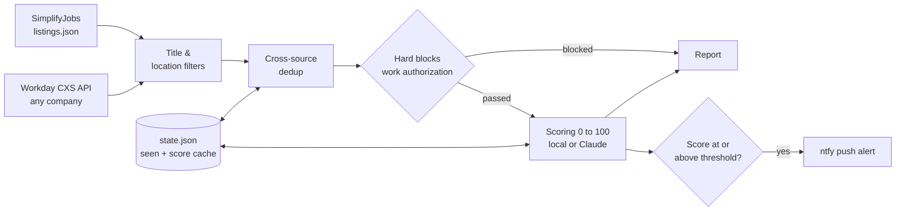

# job-radar


**An LLM-powered job discovery pipeline.** It pulls internship and co-op postings from GitHub internship trackers and Workday career sites, drops roles that fail hard eligibility rules, scores the rest against a resume, and pushes the best matches to your phone. Scoring runs **free and offline** by default, with optional LLM scoring through Claude.

Built because checking a dozen career sites by hand every day is slow, and keyword search can't tell a real fit from a title match.

---

## How it works



| Stage | What it does |
|---|---|
| **Sources** | SimplifyJobs-format `listings.json` and any Workday career site through the same CXS JSON API the career page itself calls, with pagination |
| **Filters** | Title include/exclude/require rules and location matching, applied *before* fetching Workday job details to avoid wasted requests |
| **Dedup** | A normalized company + title + location key catches the same role posted on multiple sources |
| **Hard blocks** | Drops postings requiring permanent work authorization, U.S. person status, export control, security clearance, or excluding CPT/OPT |
| **Scoring** | Two engines. **Local** (free): matches skills extracted from your resume against the posting's title and description. **Claude** (optional): rates fit with structured JSON reasons. Scores are cached so a posting is never scored twice |
| **Alerts** | ntfy.sh push notifications with score, company, title, and a tap-to-open link |
| **Report** | A ranked Markdown report per run, including what was blocked and why |

## Design decisions

- **Free by default, smarter when available.** `mode = "auto"` uses Claude when a key with credits exists and falls back to the local engine when the key is missing, the budget runs out, or the account has no credits. The pipeline never stops because of the LLM.
- **Cheap filters before paid calls.** Deterministic rules run first, so the LLM only sees postings that could actually work. A per-run budget (`max_per_run`) caps API spend.
- **Fail fast on account errors.** A bad key or empty balance is detected on the first call instead of failing once per posting.
- **Nothing gets lost.** A posting is marked seen only once it is fully processed. Postings skipped by the budget or by a transient API error are retried on the next run.
- **No backlog flood.** The first run records everything currently posted without sending alerts. From then on, you are only alerted to genuinely new postings.
- **Crash-safe state.** State is written atomically (temp file plus rename), so an interrupted run can't corrupt it.
- **Handles Workday quirks.** Workday only reports the total result count on the first page, so pagination keys off that first value.
- **Zero dependencies.** Standard library only, which makes it trivial to run anywhere and easy to test with injected fakes.
- **Fails soft.** One broken source logs a warning; the rest of the run continues.

## Quickstart

```bash
git clone https://github.com/aaditya2504/job-radar.git && cd job-radar

cp config.example.toml config.toml   # sources, filters, threshold
cp .env.example .env                 # NTFY_TOPIC; ANTHROPIC_API_KEY is optional

mkdir -p profile && cp sample_resume.md profile/resume.md   # replace with your resume
# then set resume_path = "profile/resume.md" in config.toml

python -m jobradar --dry-run   # preview: no alerts, nothing saved
python -m jobradar             # real run
```

Install the [ntfy app](https://ntfy.sh) and subscribe to your topic to get alerts. Pick a long random topic name, because ntfy topics are public.

**Scoring modes** (`[scoring] mode` in `config.toml`):

| Mode | Cost | How it scores |
|---|---|---|
| `local` | Free | Title relevance (up to 40) plus the share of the posting's skills that appear in your resume (up to 60). Title-only listings get neutral skill credit |
| `claude` | Pay per call | LLM judgment of skills, seniority, and domain fit, with written reasons |
| `auto` | Free unless a key is set | Claude when available, local otherwise |

**Add any Workday company** by pasting its careers page URL into `config.toml`:

```toml
[[workday]]
company = "NVIDIA"
url = "https://nvidia.wd5.myworkdayjobs.com/NVIDIAExternalCareerSite"
search = "intern"
```

**Run it on a schedule** (every 2 hours, via `crontab -e`):

```
0 */2 * * * cd /path/to/job-radar && /usr/bin/python3 -m jobradar >> run.log 2>&1
```

## Example report

Each run writes `reports/YYYY-MM-DD_HHMM.md` (illustrative values):

| Score | Company | Title | Location | Why |
|---|---|---|---|---|
| 88 | Acme | Data Engineering Intern | Boston, MA | Spark and Kafka match; CDC experience; co-op timing fits |
| 55 | Globex | Data Platform Intern | Remote | Strong SQL overlap; role leans toward frontend tooling |

## Tests

```bash
python -m unittest discover -s tests -t . -v
```

25 offline tests cover source parsing, Workday pagination, cross-source dedup, hard blocks, both scoring engines, score parsing and clamping, retry-on-failure semantics, fail-fast on account errors, first-run suppression, and notification encoding. CI runs them on Python 3.11, 3.12, and 3.13.

## Project structure

```
jobradar/
├── sources/
│   ├── simplify.py   # SimplifyJobs listings.json
│   └── workday.py    # Workday CXS API with pagination and detail fetch
├── filters.py        # Title, location, and work-authorization rules
├── models.py         # Job model and dedup key
├── local_scorer.py   # Free offline skill-match scoring
├── scorer.py         # Claude Messages API scoring
├── notify.py         # ntfy push alerts
├── state.py          # Seen set and score cache, atomic writes
├── pipeline.py       # Orchestration and report
└── __main__.py       # CLI
tests/                # Offline fakes and tests
```

## Security

Secrets live in `.env`, and your resume lives in `profile/`. Both are git-ignored, along with `config.toml`, run state, and reports. Only the sample resume is committed.
